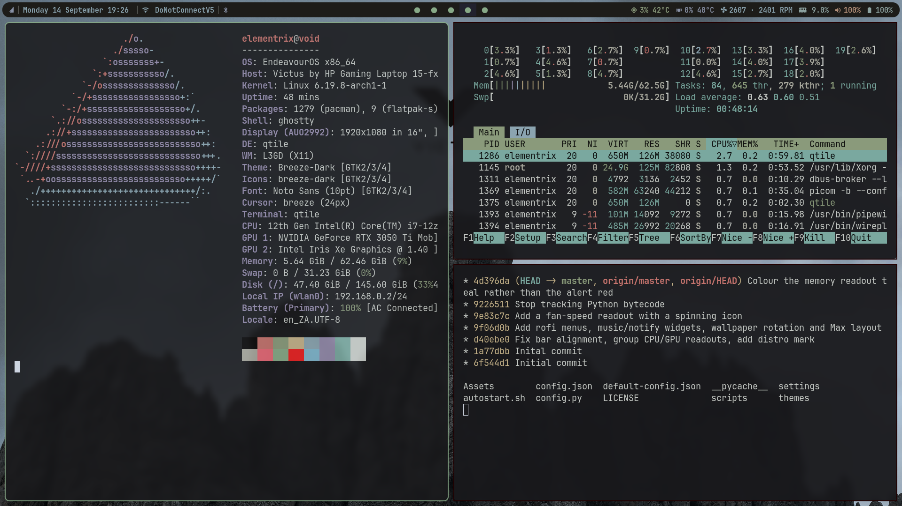
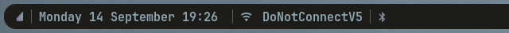
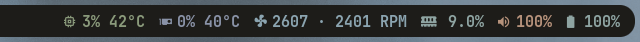

# qtile

My [qtile](https://qtile.org) desktop: a single bar with live hardware readouts,
click-to-open menus for the session, Wi-Fi and Bluetooth, BSP tiling with gaps,
drop-down scratchpads and rotating wallpapers.



## The bar




Everything on the bar is live, and the icons that make sense to click, do.

| Widget | Shows | Click |
| --- | --- | --- |
| Distro mark | – | Session menu: lock, suspend, log out, restart, shut down |
| Clock | Day, date and time | |
| Network | The connected Wi-Fi/ethernet name, or *Offline* | Wi-Fi menu: pick a network, rescan, toggle the radio |
| Bluetooth | The connected device (+ how many more); icon shades by state | Bluetooth menu: connect, pair, disconnect, toggle power |
| Music | What the current MPRIS player is playing (hidden when nothing is) | Play/pause; scroll for previous/next |
| Notifications | qtile's own notification server, so `notify-send` works without a separate daemon | Dismiss; right-click follows the notification's action |
| Workspaces | One dot per workspace that has windows | |
| System tray | Application tray icons (takes no space while empty) | |
| CPU | Load and package temperature (turns red at 90 °C) | |
| GPU | NVIDIA load and temperature; dims to just the icon while the card is powered down, and never wakes it to ask | |
| Fans | RPM of every chassis fan, behind an icon that spins in proportion to how hard they're working | |
| Memory | Used RAM | |
| Volume | Level, with an icon that tracks it | Opens `pavucontrol` |
| Battery | Charge and charger state | |

## Layout and workspaces

- **Layouts:** BSP (`Mod+Tab` cycles to Max and back).
- **Workspaces:** nine of them, `Mod+1`…`Mod+9`; only the ones with windows in
  them appear on the bar.
- **Scratchpads:** a terminal, a mixer and a file manager that drop down over
  whatever you're doing and hide again with the same key.
- **Gaps and borders** are set in `config.json`; the focused window gets the
  theme's `active` colour.

## Requirements

Arch package names; anything marked *optional* is skipped gracefully when it
isn't there.

| For | Packages |
| --- | --- |
| The window manager | `qtile`, `python-psutil` |
| Font | `ttf-jetbrains-mono-nerd` (every icon on the bar, distro mark included, comes from it) |
| Menus | `rofi` |
| Compositor and wallpaper | `picom`, `feh`, `imagemagick` |
| Wi-Fi and Bluetooth readouts/menus | `networkmanager`, `bluez-utils` |
| Volume and brightness keys | `alsa-utils`, `libpulse` (`pactl`), `pavucontrol`, `brightnessctl` |
| Default applications | `ghostty`, `firefox`, `dolphin`, `flameshot` |
| GPU readout (*optional*) | `nvidia-utils` (`nvidia-smi`) |
| Lock screen (*optional*) | any of `betterlockscreen`, `i3lock`, `xsecurelock`, `slock` |

## Install

```sh
git clone git@github.com:Verushan/qtile.git ~/.config/qtile
cd ~/.config/qtile
cp default-config.json config.json   # then edit to taste
```

Put some wallpapers in `~/Pictures/Victus` (or point `wallpapers=` in
`autostart.sh` somewhere else), then log in to qtile — or, if it's already
running, `Mod+Ctrl+R` reloads the config in place.

## Configuration

`config.json` holds the few things worth changing without touching Python:

```json
{
    "theme": "kanagawa-dragon",
    "border-width": 2,
    "gap": 10
}
```

- **theme** – the name of a file in `themes/`. `kanagawa-dragon`,
  `catppuccin-mocha` and `nord` are included; `themes/README.md` explains the
  handful of colours a theme needs if you want to add your own. The terminal
  (ghostty, and fish through it) and rofi follow the theme on the next reload;
  the login screen follows once you run `sudo ~/.config/sddm/install.sh`.
- **border-width** – window border, in pixels.
- **gap** – space between windows and around the screen, in pixels.

Default programs (`terminal`, `browser`, `file_explorer`) live at the top of
`settings/keys.py`. The wallpaper folder and how often it changes are the first
two lines of `autostart.sh`; `scripts/wallpaper.sh` pulls overly bright
pictures down so text on top of them stays readable.

### Hardware readouts

The bar reads its sensors through `psutil`, so it works on anything the kernel
exposes as hwmon, but a couple of things are tuned to the laptop it was written
on (an HP Victus 15):

- **Fans** – the icon's spin is scaled to a full-speed reading of
  `fan_max_rpm = 5400` in `settings/widgets.py`. On another machine, force
  your fans to full (`pwm1_enable=0` on hp-wmi, or a stress test), read the
  peak, and put that number in. With no fan sensor at all the widget hides.
- **CPU temperature** comes from the `coretemp` *Package id* sensor (Intel).
  On AMD, swap that for `k10temp`'s `Tctl` in `cpu_temperature()`.
- **GPU** expects an NVIDIA card; without `nvidia-smi` it shows a dimmed icon.

## Keybindings

`Mod` is the Super/Windows key.

### Windows

| Keys | Action |
| --- | --- |
| `Mod+H/J/K/L` | Focus left / down / up / right |
| `Mod+Shift+H/J/K/L` | Move window left / down / up / right |
| `Mod+Ctrl+H/J/K/L` | Grow window left / down / up / right |
| `Mod+Shift+F` | Toggle floating |
| `Mod+Shift+M` | Toggle fullscreen |
| `Mod+Shift+Q` | Close window |
| `Mod+Tab` / `Mod+Shift+Tab` | Next / previous layout |
| `Mod+Drag` (left button) | Move floating window |
| `Mod+Drag` (right button) | Resize floating window |
| `Mod+Middle-click` | Bring window to front |

### Workspaces and screens

| Keys | Action |
| --- | --- |
| `Mod+1`…`9` | Go to workspace |
| `Mod+Shift+1`…`9` | Send window to workspace |
| `Mod+.` / `Mod+,` | Focus next / previous monitor |

### Scratchpads

| Keys | Drops down |
| --- | --- |
| `Mod+Shift+Enter` | Terminal |
| `Mod+Shift+V` | Mixer (`alsamixer`) |
| `Mod+Shift+E` | File manager |

### Applications

| Keys | Action |
| --- | --- |
| `Mod+Enter` | Terminal |
| `Mod+B` | Browser |
| `Mod+E` | File manager |
| `Mod+P` | Application launcher (`rofi -show drun`) |
| `Mod+Shift+P` | Window switcher |
| `Mod+Shift+S` | Screenshot (`flameshot`) |

### Hardware

| Keys | Action |
| --- | --- |
| `Mod+Up` / `Mod+Down` | Volume up / down |
| `Mod+M` | Mute |
| `Mod+Right` / `Mod+Left` | Brightness up / down |

### qtile

| Keys | Action |
| --- | --- |
| `Mod+Ctrl+R` | Reload config |
| `Mod+Ctrl+Q` | Quit qtile |

## Layout of the repo

```
config.py            entry point; pulls everything from settings/
settings/
  widgets.py         the bar and every widget on it
  keys.py            keybindings and default programs
  groups.py          workspaces and scratchpads
  layouts.py         BSP and Max
  screens.py         the bar's screen placement
  theme.py           loads themes/<name>.json
scripts/
  power-menu.sh      session menu (rofi)
  wifi-menu.sh       Wi-Fi menu (rofi + nmcli)
  bluetooth-menu.sh  Bluetooth menu (rofi + bluetoothctl)
  wallpaper.sh       picks and dims a wallpaper
  menu.sh            shared rofi helpers
  apply-theme.py     carries the theme over to ghostty and rofi
autostart.sh         wallpaper rotation, picom, screen-blanking off
themes/              colour schemes
```

## Credits

The `settings/` split started from
[Antonio Sarosi's dotfiles](https://github.com/antoniosarosi/dotfiles).
Licensed under the [MIT License](LICENSE).
